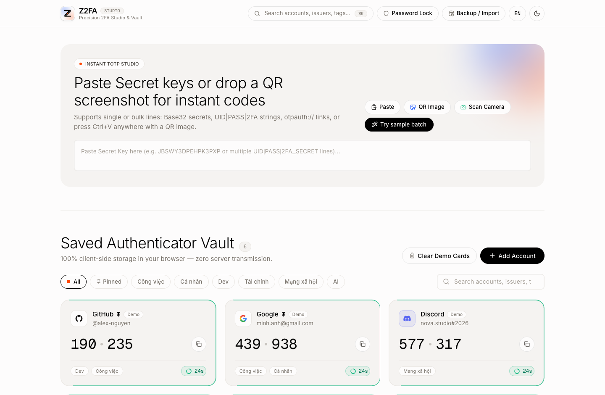
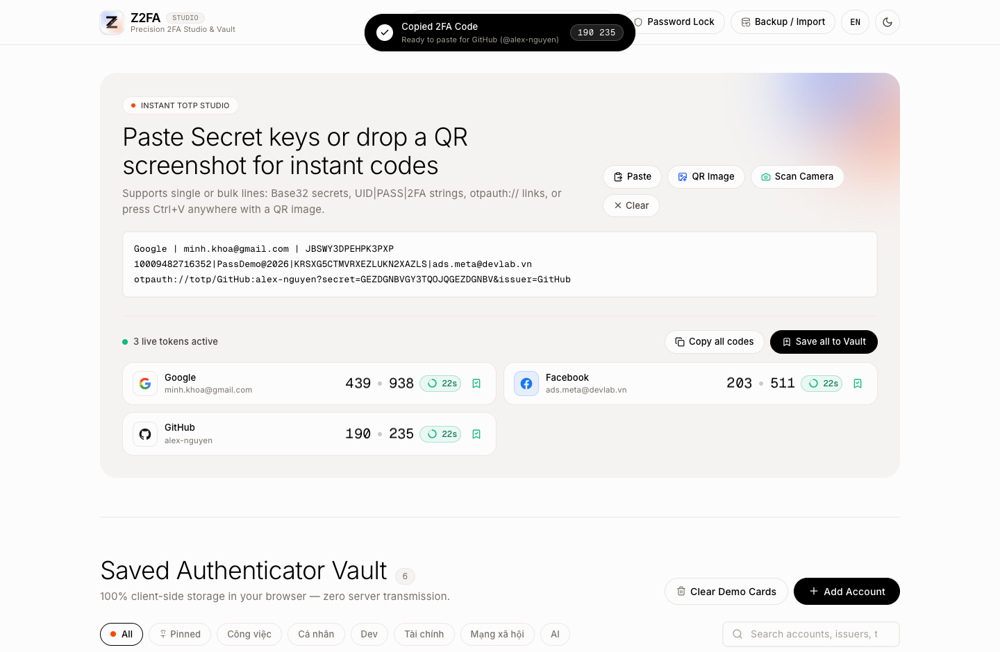
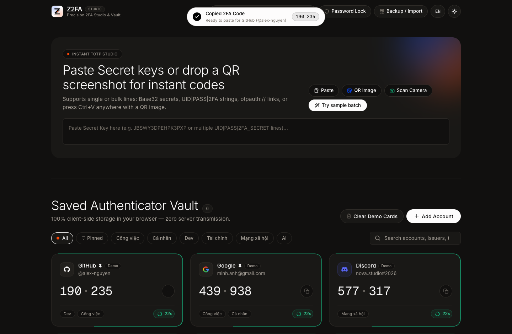
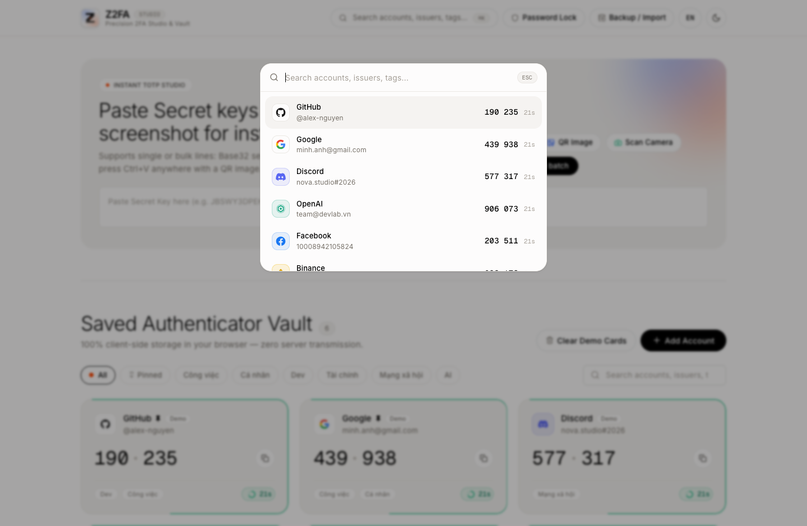
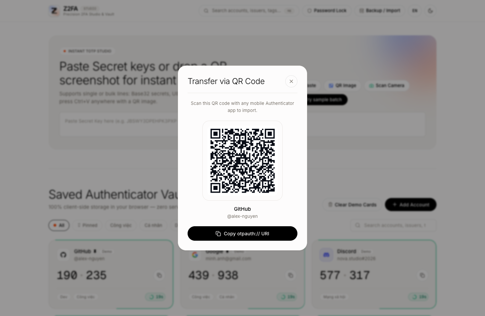
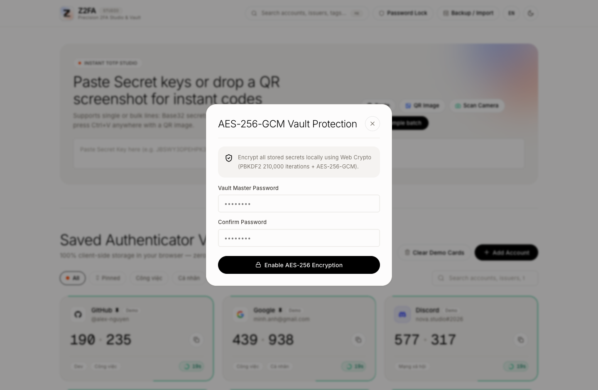
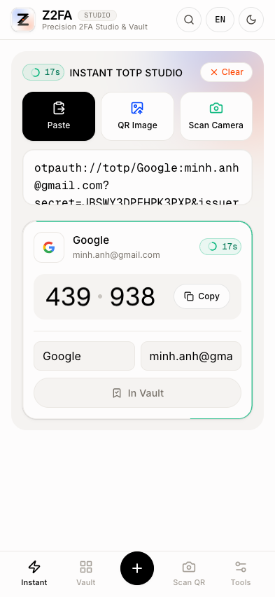
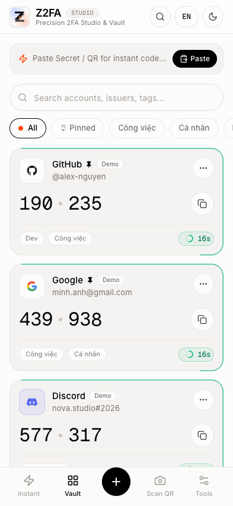
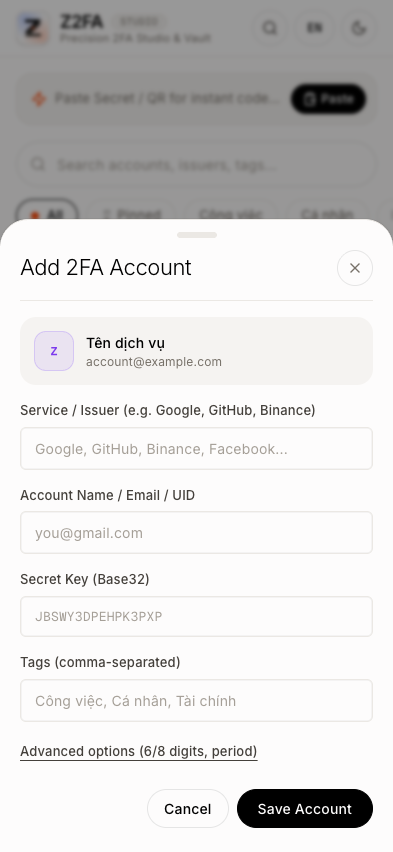
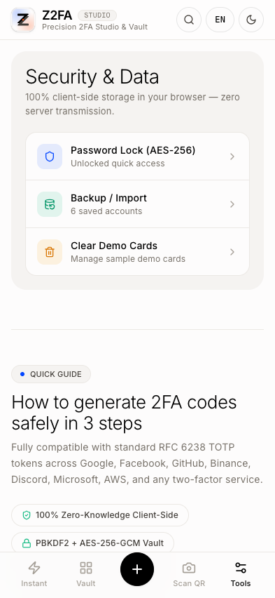

<div align="center">
  
  <h1>Z2FA — Precision 2FA Studio &amp; Vault</h1>
  <p><strong>Instant RFC 6238 TOTP Generator &amp; Zero-Knowledge AES-256 Browser Vault.</strong></p>
  <p>
    <a href="https://z2fa.devlab.vn"><strong>Live App (z2fa.devlab.vn)</strong></a>
    &nbsp;·&nbsp;
    <a href="#screenshots">Screenshots</a>
    &nbsp;·&nbsp;
    <a href="https://github.com/zane-tv/z2fa/issues">Report Issue</a>
  </p>
</div>

<p align="center">
  
</p>

---

## Overview

**Z2FA** combines the speed of an instant TOTP generator with a refined personal authenticator vault, crafted in a **Warm Editorial Bauhaus** aesthetic (`#fdfcfc` Eggshell, `#f5f3f1` Warm Taupe, `#000000` Ink) on desktop and a **Thumb-First Native App Shell** on mobile.

Every cryptographic operation — TOTP token generation, QR image decoding, and vault encryption — executes **100% locally inside your browser** via the native Web Crypto API. Zero secrets or account metadata are ever transmitted to any server.

---

## Screenshots

### Desktop Experience

<table>
  <tr>
    <td width="50%" align="center">
      
      <br />
      <sub><strong>Bulk Live TOTP Stream &amp; Dynamic Island Toast</strong></sub>
    </td>
    <td width="50%" align="center">
      
      <br />
      <sub><strong>Warm Ink Dark Mode</strong></sub>
    </td>
  </tr>
  <tr>
    <td width="50%" align="center">
      
      <br />
      <sub><strong><code>⌘K</code> Quick Jump &amp; Instant Copy</strong></sub>
    </td>
    <td width="50%" align="center">
      
      <br />
      <sub><strong>Device Transfer via <code>otpauth://</code> QR Code</strong></sub>
    </td>
  </tr>
  <tr>
    <td colspan="2" align="center">
      
      <br />
      <sub><strong>Zero-Knowledge PBKDF2 + AES-256-GCM Vault Encryption</strong></sub>
    </td>
  </tr>
</table>

### Mobile Native-Feel App Shell

<table>
  <tr>
    <td width="25%" align="center">
      
      <br />
      <sub><strong>Instant Studio &amp; Live Pass</strong></sub>
    </td>
    <td width="25%" align="center">
      
      <br />
      <sub><strong>Saved Vault &amp; Filter Pills</strong></sub>
    </td>
    <td width="25%" align="center">
      
      <br />
      <sub><strong>Spring Bottom Sheet</strong></sub>
    </td>
    <td width="25%" align="center">
      
      <br />
      <sub><strong>Security, Backup &amp; Guide</strong></sub>
    </td>
  </tr>
</table>

---

## Key Features

- **Instant TOTP Studio**
  - Paste a single Base32 secret, `otpauth://totp/...` URI, Google Authenticator export URI (`otpauth-migration://`), or bulk multi-line strings (`UID|PASS|2FA_SECRET|EMAIL`) to stream live 6-digit / 8-digit tokens immediately.
  - Press **`Ctrl+V` / `Cmd+V`** anywhere on the page with a QR screenshot in your clipboard, drag and drop a QR image, or scan directly with your device camera.
- **60fps Motion & Anti-Expiry Smart Copy**
  - **Spring Odometer Reels**: Individual digits roll smoothly with physical spring dynamics on every 30-second cycle.
  - **Color-Coded Perimeter Countdown**: Card borders and timer badges transition smoothly from Emerald (`> 8s`) to Warm Amber (`≤ 8s`) and Ember (`≤ 4s`).
  - **Smart Copy**: Automatically previews the upcoming code at `≤ 5s` remaining, and copies the fresh next-cycle token automatically if you tap copy during the final `2s` window — complete with **Dynamic Island** feedback and mobile haptics.
- **Personal Vault & Zero-Knowledge Security**
  - Automatic colorful brand recognition for 15+ popular services (Google, GitHub, Facebook, Binance, Discord, OpenAI, Telegram, Microsoft, Apple, AWS, Cloudflare, Shopee, TikTok, Steam, X, and more).
  - Pin favorites, filter with animated category pills, jump & copy via **`⌘K / Ctrl+K`**, and generate transfer QR codes for any saved account.
  - Optional **AES-256-GCM** master password protection (`PBKDF2` with `210,000` SHA-256 iterations) plus JSON backup export/import.
- **Native-Feel Mobile Experience & Offline PWA**
  - Dedicated mobile bottom tab bar (`Instant` · `Vault` · `+` · `Scan QR` · `Tools`), spring bottom sheets, and full offline Progressive Web App (PWA) support across iOS, Android, macOS, and Windows.
  - Bilingual interface (**English** & **Vietnamese**) with **Light** and **Dark** modes.

## Tech Stack

- **Framework**: React 19, TypeScript, Vite 6
- **Styling & Typography**: Tailwind CSS v4, Inter (`300` / `400` / `500`) & Geist Mono
- **Animations**: Framer Motion (`spring` odometer reels, FLIP `layout` cards, Dynamic Island)
- **Cryptography & QR**: Web Crypto API (`HMAC SHA-1/256/512`, `AES-256-GCM`, `PBKDF2`), `jsQR`, `qrcode`, `vite-plugin-pwa`

## Getting Started

```bash
# Install dependencies
pnpm install

# Start local development server (http://localhost:5173)
pnpm run dev

# Type-check and build production bundle
pnpm run build

# Preview production build locally
pnpm run preview
```

## Project Structure

```text
├── docs/screenshots/       # Desktop & Mobile UI screenshots for documentation
├── public/                 # Favicon, PWA icons, Open Graph card, robots.txt, sitemap.xml, llms.txt
├── src/
│   ├── components/
│   │   ├── DynamicIslandToast.tsx
│   │   ├── Modals.tsx
│   │   ├── OdometerCode.tsx
│   │   ├── PerimeterCountdown.tsx
│   │   ├── QuickStudio.tsx
│   │   ├── SeoEditorialSection.tsx
│   │   ├── TotpCard.tsx
│   │   └── Z2FALogo.tsx
│   ├── lib/
│   │   ├── brands.tsx      # Brand SVG detection & color plates
│   │   ├── cryptoVault.ts  # PBKDF2 + AES-256-GCM Web Crypto encryption
│   │   ├── i18n.ts         # Bilingual EN / VI dictionary
│   │   ├── parser.ts       # Base32, bulk UID|PASS|2FA, otpauth & Google Migration parser
│   │   ├── qr.ts           # Local Canvas QR decoder & QR image generator
│   │   └── totp.ts         # RFC 6238 / RFC 4226 HMAC engine
│   ├── App.tsx
│   └── index.css           # Design tokens & editorial surfaces
└── vercel.json             # Security & immutable asset caching headers
```

## Security Model

1. **Zero Network Calls for Secrets**: Secrets never leave browser memory or `localStorage`.
2. **Authenticated Encryption**: Enabling a vault password derives a 256-bit key using `PBKDF2-HMAC-SHA256` (`210,000` iterations, random 16-byte salt) and encrypts your vault with `AES-256-GCM` (random 12-byte IV on every write).

## License

MIT © [zane-tv](https://github.com/zane-tv)
